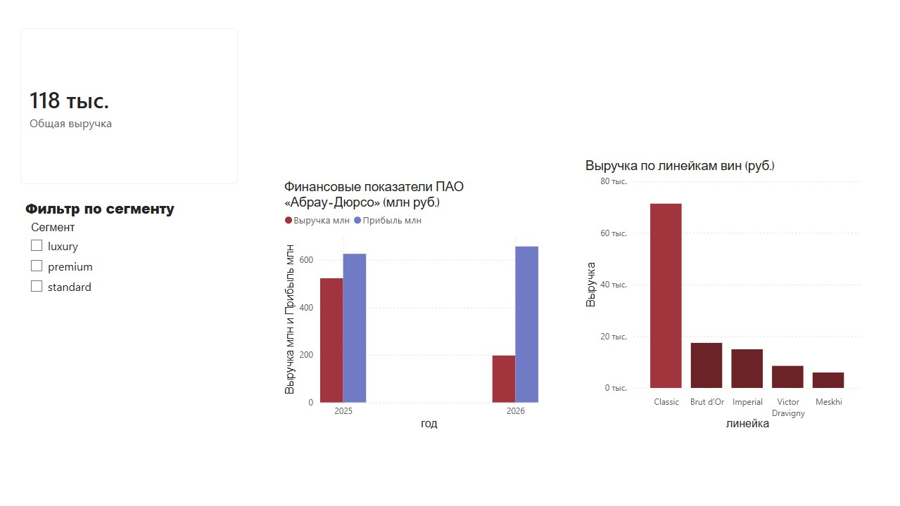

# Аналитика портфеля вин ПАО «Абрау-Дюрсо»

SQL-проект по анализу продуктовой матрицы и финансовых показателей ведущего российского производителя игристых вин.

## О проекте

Аналитическое исследование портфеля вин «Абрау-Дюрсо» с использованием реляционной базы данных и продвинутых SQL-запросов. Проект демонстрирует навыки работы с оконными функциями, CTE и бизнес-аналитики.

## Бизнес-задачи

1. Определить, какие линейки вин генерируют основную выручку
2. Выявить распределение продаж по принципу Парето (80/20)
3. Проанализировать финансовые показатели компании на основе реальной отчётности

## Источники данных

| Данные | Источник | Тип |
|--------|----------|-----|
| Каталог продукции | Официальный сайт abraudurso.ru | Реальные данные |
| Финансовые показатели | БФО ПАО «Абрау-Дюрсо» за 1 полугодие 2025-2026 гг. | Реальные данные из отчётности |
| Паттерны продаж | Адаптированы из UCI Online Retail Dataset | Синтетические (для демонстрации SQL) |

## Структура базы данных

- **wines** (10 записей) — каталог вин: название, линейка, тип, сорт винограда, год урожая, крепость, сахар, сегмент, цена
- **sales** (20 транзакций) — продажи: ID продажи, ID вина, клиент, дата, количество, канал (retail/horeca)
- **financials** (2 периода) — финансовые показатели: год, период, выручка, чистая прибыль, источник

## Ключевые инсайты

### 1. Анализ выручки по линейкам
- **Classic** (массовый сегмент): 102 бутылки, 71 358 руб — **60% выручки**
- **Brut d'Or + Imperial** (люкс): 8 бутылок, 32 420 руб — **27% выручки**
- **Victor Dravigny + Meskhi** (премиум): 9 бутылок, 14 510 руб — **13% выручки**

### 2. Принцип Парето в действии
ТОП-4 вина из 9 (44% ассортимента) генерируют **86.5% всей выручки**:
1. Classic белое брют — 39.0%
2. Classic белое полусухое — 59.1% (накопительно)
3. Brut d'Or Blanc de Blancs — 73.8%
4. Imperial Кюве — 86.5%

### 3. Финансовая динамика (реальные данные из БФО)
- Выручка 1 полугодие 2025: **522.8 млн руб**
- Выручка 1 полугодие 2026: **197.5 млн руб** (снижение на 62%)
- Чистая прибыль 2025: **625.6 млн руб**
- Чистая прибыль 2026: **656.6 млн руб** (рост на 5%)

**Вывод:** Несмотря на падение операционной выручки, чистая прибыль выросла благодаря инвестиционным доходам (900 млн руб от участия в дочерних структурах).

##  SQL-запросы

### Запрос 1: Выручка по линейкам и сегментам
```sql
SELECT 
    w.line AS 'Линейка',
    w.segment AS 'Сегмент',
    SUM(s.quantity_bottles) AS 'Продано бутылок',
    ROUND(SUM(s.quantity_bottles * w.recommended_price_rub), 0) AS 'Выручка (руб)'
FROM sales s
JOIN wines w ON s.wine_id = w.wine_id
GROUP BY w.line, w.segment
ORDER BY 'Выручка (руб)' DESC;
WITH wine_revenue AS (
    SELECT 
        w.wine_id, w.name AS wine_name, w.line, w.segment,
        SUM(s.quantity_bottles) AS total_bottles,
        ROUND(SUM(s.quantity_bottles * w.recommended_price_rub), 0) AS revenue
    FROM sales s
    JOIN wines w ON s.wine_id = w.wine_id
    GROUP BY w.wine_id, w.name, w.line, w.segment
),
ranked_wines AS (
    SELECT 
        wine_name, line, segment, total_bottles, revenue,
        ROW_NUMBER() OVER (ORDER BY revenue DESC) AS rnk,
        SUM(revenue) OVER (ORDER BY revenue DESC) AS cumulative_revenue,
        SUM(revenue) OVER () AS total_revenue
    FROM wine_revenue
)
SELECT 
    rnk AS 'Рейтинг',
    wine_name AS 'Название вина',
    line AS 'Линейка',
    segment AS 'Сегмент',
    total_bottles AS 'Продано бутылок',
    revenue AS 'Выручка (руб)',
    ROUND(cumulative_revenue, 0) AS 'Накопительная выручка',
    CONCAT(ROUND(cumulative_revenue / total_revenue * 100, 1), '%') AS 'Доля от общей выручки',
    CASE 
        WHEN cumulative_revenue / total_revenue * 100 <= 80 THEN 'ТОП-20% (Парето)'
        ELSE 'Остальные 80%'
    END AS 'Категория Парето'
FROM ranked_wines
ORDER BY rnk;
## Визуализация в Power BI
   

Интерактивный дашборд создан в **Power BI Desktop** и включает:

### Ключевые визуализации:
1. **Финансовые показатели ПАО «Абрау-Дюрсо» (млн руб.)**
   - Выручка и чистая прибыль за 1 полугодие 2025 и 2026 гг.
   - Показывает рост прибыли (+5%) несмотря на падение выручки (-62%)

2. **Выручка по линейкам вин (руб.)**
   - Classic генерирует ~60% выручки (71 358 руб.)
   - Люксовые линейки (Brut d'Or, Imperial) дают ~27% при малых объемах

3. **Интерактивный фильтр по сегментам**
   - Позволяет анализировать данные в разрезе standard/premium/luxury

4. **KPI-карточка** — общая выручка портфеля

### Файл дашборда:
`Abrau_Durso_Dashboard.pbix` — откройте в Power BI Desktop для интерактивного анализа
